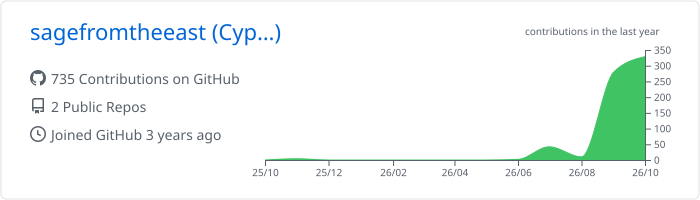
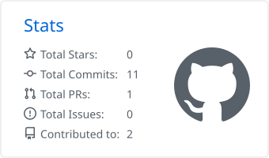
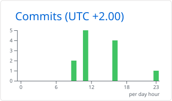

### 👋 Hey, I'm sagefromtheeast.

Computer Science graduate building practical software, data experiments, and privacy-first tools. I use AI as a collaborator — I plan the product, write and review the code, and learn as I build.

 Based in Zimbabwe · ⚽ football and data · 🔒 privacy-first tools · 🧠 learning in public

---

#### 💫 About me

- 🎓 **Background:** BTech in Computer Science  
- 🤖 **How I build:** AI-assisted development — I drive the product and code; AI is a partner, not a crutch  
- ⚽ **Into:** coding, data science, football analytics  
- 🔒 **Care about:** tools that help everyday people keep their data private

---

#### 🛠️ What I build with

  

Plus shadcn/ui, React Query, Zustand, Dexie, Recharts and jsPDF when a project calls for them.

---

#### 📦 Featured projects

**🎓 Key university project**
- **[SAG3-PARK](https://github.com/sagefromtheeast/SAG3-PARK)** — A parking management system that reads number plates from photos (YOLO + EasyOCR), identifies vehicles, and allocates spots. Tech hi[...]

**🖍️ Building now**
- **[Nestmark](https://github.com/sagefromtheeast/sage-highlights-unleashed)** — Browser extension for highlighting the web and keeping it. Highlights persist on revisit and can be exported. Tech: T[...]

**⚽ Football**
- **[Red Buzz](https://github.com/sagefromtheeast/football-tg-bot)** — A Telegram bot that filters Man Utd news from trusted X accounts and posts it to a channel, running for $0 on Cloudflare Worker[...]
- **[Toby-Tactics](https://github.com/sagefromtheeast/Toby-Tactics)** — Football tactics board and visual editor. Tech: React, React Spring, Dexie.

**🤖 Bots and experiments**
- **[Podcast Telegram Notifier](https://github.com/sagefromtheeast/podcast-telegram-notifier)** — Watches podcast RSS feeds and sends new episodes to Telegram with artwork, show notes and listen but[...]
- **[Watermark-Remover](https://github.com/sagefromtheeast/Watermark-Remover)** — Research experiment exploring approaches to remove or understand synthetic watermarks (experimental / research-only)[...]

**🧰 Everyday tools**
- **[Penny-Wise](https://github.com/sagefromtheeast/Penny-Wise)** — A budgeting app for tracking expenses and categories. Tech: React, local storage / client DB.  
- **[Glen-Norah-Youth-Management-System](https://github.com/sagefromtheeast/Glen-Norah-Youth-Management-System)** — Dashboard for running a youth group with PDF export. Tech: React, Firebase.

**🎵 Community and faith**
- **[Shona-Song-Book](https://github.com/sagefromtheeast/Shona-Song-Book)** — A Shona songbook (my first full-stack app) with export and a privacy policy.  
- **[Soul-Feed-Store](https://github.com/sagefromtheeast/Soul-Feed-Store)** — Small e-commerce site for Christian fashion. Tech: React, Vite, Express.

---

#### 📊 Stats and highlights

<picture>
  <source media="(prefers-color-scheme: dark)" srcset="https://streak-stats.demolab.com?user=sagefromtheeast&theme=github-dark-blue&hide_border=true">
  
</picture>

🔥 Total contributions · current streak · longest streak

📅 Daily contributions over the last year

<picture>
  <source media="(prefers-color-scheme: dark)" srcset="./profile-summary-card-output/github_dark/0-profile-details.svg">
  
</picture>

<picture>
  <source media="(prefers-color-scheme: dark)" srcset="./profile-summary-card-output/github_dark/3-stats.svg">
  
</picture>
<picture>
  <source media="(prefers-color-scheme: dark)" srcset="./profile-summary-card-output/github_dark/4-productive-time.svg">
  
</picture>

---

#### 🌱 Right now

- 📖 Getting better at reading and writing code without the AI doing the heavy lifting  
- 📈 Learning data science, using football data as my playground  
- 🛡️ Looking for privacy problems worth building small, practical tools for

If any of that overlaps with what you're doing, open an issue on one of my repos and say hi.

---

#### ✍️ Random dev quote

<picture>
  <source media="(prefers-color-scheme: dark)" srcset="https://quotes-github-readme.vercel.app/api?type=horizontal&theme=dark">
  
</picture>
